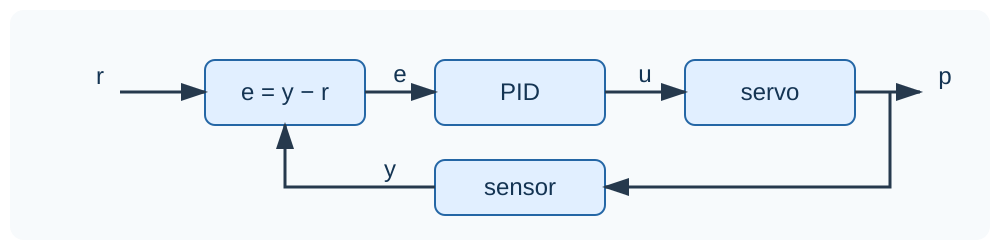
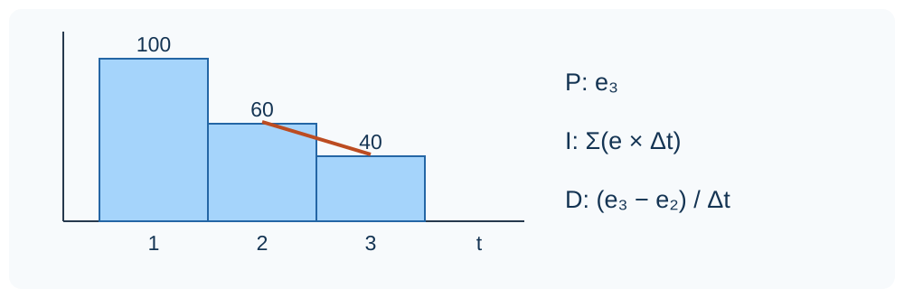

# How does a PID controller work?

You have viewed the gripper's sensor readings. How could the gripper use those readings to adapt to an object? A **feedback controller** measures the result, compares it with a target and adjusts its output. Think of cycling up a hill: you look at your speed and adjust your effort.

## From measurement to correction

</img>

In the diagram, `r` is the desired sensor value, `y` is the measurement, `e` is the error and `u` is the output. The servo and gripper affect the physical pressure `p`; the sensor converts it into measurement `y`. This gripper's firmware specifically calculates `e = y - r`: the measured ADC value minus the target. Other controllers sometimes use the opposite convention; the direction of their output must then be adjusted too.

The pressure sensor supplies a raw ADC value in **counts**, not a force in newtons. For this sensor the value falls as pressure increases. For example, with target `r = 1250`:

| Measurement `y` | Error `e = y - r` | Meaning for this gripper |
|---|---:|---|
| 1600 | +350 | Less pressure than the target; the controller requests a closing movement. |
| 1250 | 0 | The measurement equals the target. |
| 1100 | -150 | More pressure than the target; the controller requests an opening movement. |

These are illustrative values, not safe settings. Here the output is **servo angular speed** in degrees per second, not force. The distance sensor is also reported, but is not the feedback used by this pressure controller.

## Three ways to look at the error

A PID controller adds three contributions: `u = Kp × e + Ki × I + Kd × D`. `Kp`, `Ki` and `Kd` are adjustable gains; `I` and `D` are the accumulated error and the change in error. Each contribution must have units consistent with `u`.

</img>

Suppose the errors in three equal intervals of 0.1 seconds are 100, 60 and 40 counts. The rectangles show a simplified example: each has width 0.1 s.

### P: the current error

**Proportional** control reacts to the error now: `P = Kp × e`. With `Kp = 0.04` and `e = 40`, `P = 1.6 degrees/s`. A larger error produces a larger correction. Too much gain can cause overshoot or oscillation; too little can make the response slow.

### I: the error that accumulates

The **integral** term accounts for previous errors. A digital controller can calculate `I = I + e × Δt` after each interval. Starting at zero, after three intervals `I = (100 + 60 + 40) × 0.1 = 20 count·s`. The I contribution is `Ki × I`: an error that persists can therefore have more influence. A negative error reduces the sum.

If the servo is already at a limit, further accumulation can cause an excessive correction later: this is called *integral windup*. The example firmware limits the integral and prevents further accumulation when the error would push farther past a speed or travel limit. It also clears the history on a mode change and in the deadband.

### D: how quickly the error changes

The **derivative** term looks at the slope: `D = (new error - previous error) / Δt`. Here that is `(40 - 60) / 0.1 = -200 count/s`. With a positive `Kd`, this makes a negative contribution: the error is already decreasing, so the correction is reduced. A high D gain can strongly amplify sensor noise. There is no previous error for the first sample, so the firmware uses a zero D contribution then.

The three contributions do not predict the final position: the effect also depends on the gripper, sensor, limits and time between measurements.

## From formula to example firmware

The `parallel_gripper_servo_with_sensors_pid` example has `kp = 0.04`, but `ki = 0` and `kd = 0`. **Only P is active by default**; the code also calculates I and D, but they contribute nothing while their gains are zero.

With `y = 1600`, `r = 1250` and an interval of 0.01 s, the error is `350` counts. P requests `0.04 × 350 = 14 degrees/s`; without limiting, the commanded servo angle changes by `14 × 0.01 = 0.14 degrees` in that interval. The firmware limits speed and servo angle and uses the actual elapsed time, with at least 10 ms between updates. This is a calculation, not a measured physical movement.

There is a **deadband** around the target: no correction is made when the error is at most 10 counts in either direction. A close command completes only after the measurement remains inside it continuously for 100 ms. If that does not happen within 10 seconds, the firmware reports failure and holds the last commanded angle.

## Think it through

1. The target stays at 1250 and the measurement becomes 1300. Calculate the error and P speed with `kp = 0.04`. Which direction does the controller request?
2. The errors are 30 and then 10 counts, 0.1 s apart. What is the change per second? Is the error increasing or decreasing?
3. Why is a value that stays in the deadband for 100 ms more convincing than a single sample in the band?

**Check:** 1. `+50` counts and `+2 degrees/s`, so close. 2. `(10 - 30) / 0.1 = -200 count/s`; the error is decreasing. 3. One sample can land in the band by chance because of noise; even 100 ms does not guarantee a safe grip.

In the next learning object you will explore the firmware and its Python control. Do not change gains or the pressure target on a real gripper without supervision, calibration and an independent way to cut power.
