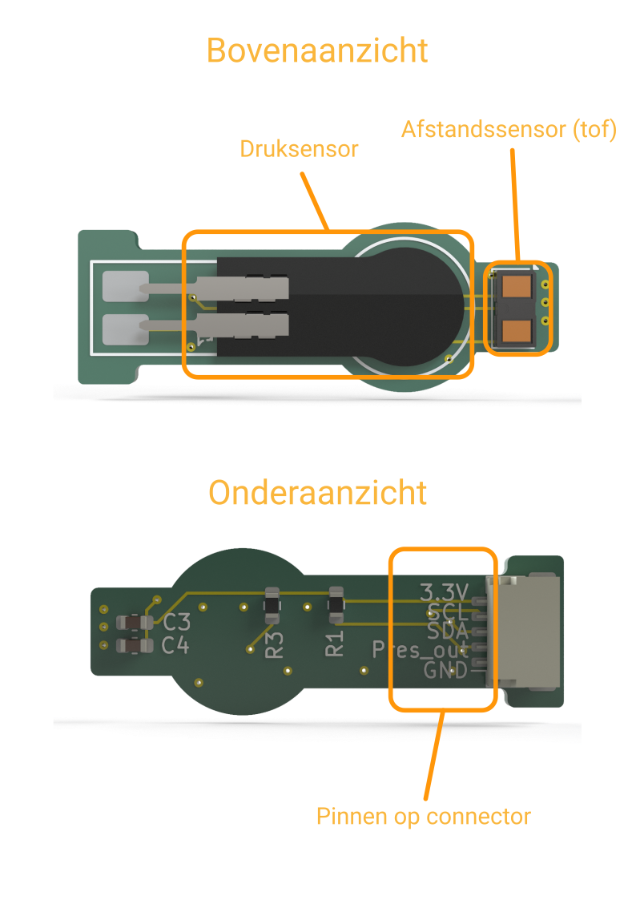
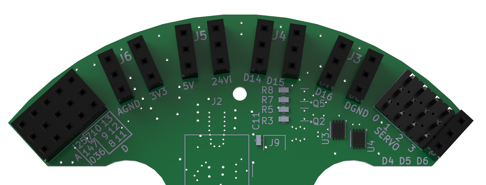

# Sensormetingen bekijken met Python

In de vorige stap bestuurde je een parallelle grijper via BLE. Nu gebruik je de vingertopsensormodule om de drukspanning en de afstand tot een voorwerp te bekijken. Je hebt hiervoor de Halberd, een aangesloten sensormodule en dezelfde Python-omgeving als eerder nodig.

### Sluit de sensormodule aan

Schakel de voeding uit voordat je iets aansluit. Verbind de sensormodule met de Halberd:

| Pin op de sensormodule | Pin op de Halberd | Functie |
| --- | --- | --- |
| `3.3V` | `3.3V` | Voeding |
| `GND` | `GND` | Massa |
| `SDA` | `D16` | I2C-data voor de afstandssensor |
| `SCL` | `D15` | I2C-klok voor de afstandssensor |
| `Pres_out` | `A0` | Analoge meetwaarde van de druksensor |

</img>

</img>

Controleer de labels, bedrading en voedingsspanning van jouw module en bord. De afstandssensor gebruikt I2C via `Wire`; de druksensor gebruikt de analoge ingang `A0`.

### Upload de firmware met sensoren

1. Open *File \> Examples \> HalberdGripper \> parallel_gripper_servo_with_sensors* en sla een eigen kopie op. De [broncode](https://github.com/dwengovzw/dwengo_nrf52_core/tree/main/nrf52/1.0.1/libraries/HalberdGripper/examples/parallel_gripper_servo_with_sensors) is ook online beschikbaar.
2. Kies een unieke `GRIPPER_NAME` en neem de veilig gekalibreerde servo-aansluitingen, pulsbreedtes, openingsgrenzen en geometrie uit je vorige firmware over. Deze sketch stuurt ook servo's aan, zelfs als je alleen de sensoren wilt bekijken. Werk veilig: houd vingers uit het mechanisme en schakel de servovoeding uit als je geen beweging wilt.
3. Compileer en upload de sketch. Open de seriële monitor op 115200 baud. Controleer de opstartmelding en `VL53L4CD detected on Wire.`. Verschijnt `VL53L4CD time-of-flight sensor not found, check wiring!`, schakel dan de voeding uit en controleer de verbindingen.

De sketch declareert de kanalen `tof` (afstand in millimeter) en `pressure` (spanning in volt) met `configureSensor`. In `loop()` leest de sketch de sensoren en geeft hij de waarden via `reportSensor` door aan de BLE-bibliotheek.

### Teken de metingen

Gebruik dezelfde werkmap en actieve virtuele omgeving als voor `gripper.py`. Installeer daarin eenmaal de extra grafiekbibliotheek:

<pre><code class="language-bash">python -m pip install matplotlib
</code></pre>

Maak in die werkmap een nieuw bestand `sensoren.py` met onderstaande code. De standaardnaam komt overeen met de sensorsketch; vervang `gripper-left-sensors` door jouw `GRIPPER_NAME` als je die wijzigde. Sluit eerst `gripper.py` of een andere BLE-client af.

<pre><code class="language-python" data-filename="sensoren.py">import time
from collections import deque

import matplotlib.pyplot as plt
from airo_robots.grippers import HalberdBLEGripper
from airo_robots.grippers.hardware.halberd_ble.client import HalberdConnectionError

gripper = HalberdBLEGripper.connect(name="gripper-left-sensors")
try:
    names = [sensor.name for sensor in gripper.sensors]
    if "tof" not in names or "pressure" not in names:
        raise RuntimeError(f"Sensoren ontbreken in de firmware: {names}")

    times = deque(maxlen=300)
    distances = deque(maxlen=300)
    pressures = deque(maxlen=300)
    plt.ion()
    fig, axes = plt.subplots(2, 1, sharex=True)
    distance_line, = axes[0].plot([], [])
    pressure_line, = axes[1].plot([], [])
    axes[0].set_ylabel("Afstand (mm)")
    axes[1].set_ylabel("Drukspanning (V)")
    axes[1].set_xlabel("Tijd (s)")
    fig.suptitle("Wachten op sensormetingen")
    plt.show(block=False)
    started = time.monotonic()

    while plt.fignum_exists(fig.number):
        try:
            readings = gripper.sensor_values
        except HalberdConnectionError as error:
            if str(error) != "No sensor snapshot received from the gripper yet.":
                raise
            plt.pause(0.2)
            continue
        values = dict(zip(names, readings, strict=True))
        times.append(time.monotonic() - started)
        distances.append(values["tof"])
        pressures.append(values["pressure"])
        distance_line.set_data(times, distances)
        pressure_line.set_data(times, pressures)
        fig.suptitle("Laatst ontvangen sensormetingen")
        for axis in axes:
            axis.relim()
            axis.autoscale_view()
        plt.pause(0.2)
finally:
    gripper.disconnect()
</code></pre>

Voer `python sensoren.py` uit. Het venster toont de laatst ontvangen afstand en drukspanning doorheen de tijd. Houd een voorwerp voor de afstandssensor of druk voorzichtig op de druksensor en bekijk hoe de grafieken veranderen. Sluit het venster om de verbinding te verbreken.

### Wat betekenen de waarden?

De drukwaarde is een spanning, geen gekalibreerde kracht. Een afstandsmeting kan ongeldig zijn. De voorbeeldfirmware kan vóór een eerste geldige afstand `0` rapporteren en daarna de laatst geldige afstand blijven tonen als een meting mislukt; de grafiek bewijst dus niet dat elke waarde actueel of geldig is. Vergelijk met de seriële monitor en gebruik de waarden niet als veiligheidsstop.

De bibliotheek meldt sensoren alleen wanneer een waarde verandert. Blijft het venster op metingen wachten, verander dan voorzichtig de sensorinvoer en controleer de seriële uitvoer en bedrading. Controleer ook de exacte BLE-naam, Bluetooth en of geen andere client verbonden is. Een verbroken verbinding of ontbrekend sensorkanaal levert een foutmelding op.
