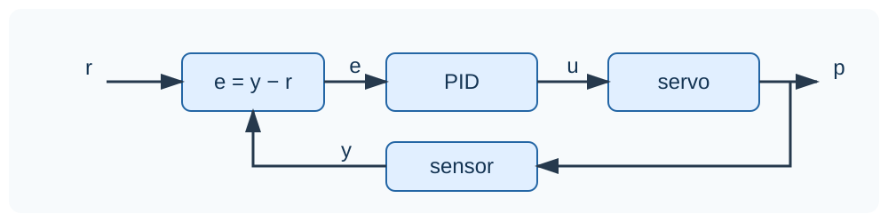
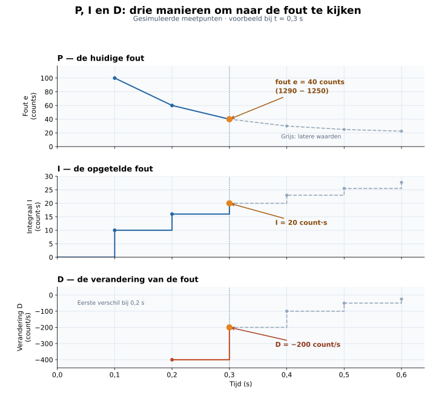
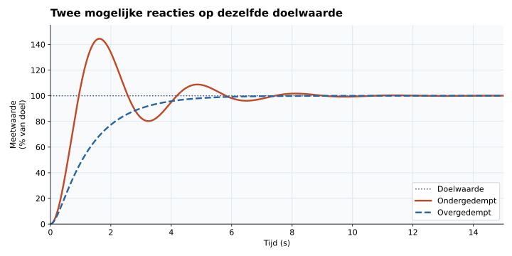
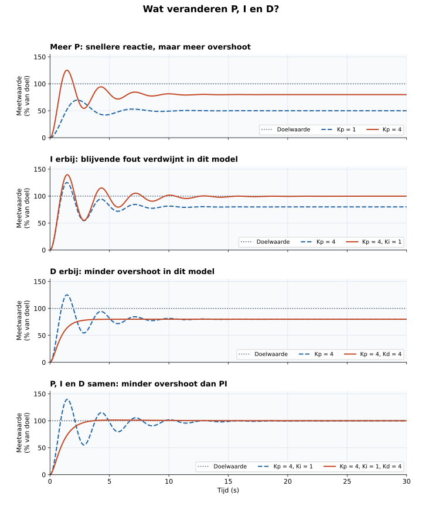

# Hoe werkt een PID-regelaar?

Je hebt de sensorwaarden van de grijper bekeken. Hoe kan de grijper die metingen gebruiken om zich aan een voorwerp aan te passen? Een **regelaar met terugkoppeling** meet het resultaat, vergelijkt het met een doel en past de aansturing aan. Vergelijk dit met fietsen op een helling: je kijkt naar je snelheid en past je inspanning aan.

## Van meting naar correctie

</img>

In de afbeelding is \\(r\\) de gewenste sensorwaarde, \\(y\\) de meting, \\(e\\) de afwijking en \\(u\\) de aansturing. De servo en grijper beïnvloeden de fysieke druk \\(p\\); de sensor zet die om naar meting \\(y\\). In deze grijper berekent de firmware specifiek \\(e = y - r\\): de gemeten ADC-waarde min de doelwaarde. Andere regelaars gebruiken soms de omgekeerde afspraak; ook de richting van de aansturing moet dan aangepast worden.

De druksensor geeft een ruwe ADC-waarde in **counts**, geen kracht in newton. Bij deze sensor daalt de waarde wanneer de druk toeneemt. Voorbeeld met doel \\(r = 1250\\):

| Meting \\(y\\) | Fout \\(e = y - r\\) | Betekenis voor deze grijper |
|---|---:|---|
| 1600 | +350 | Minder druk dan het doel; de regelaar vraagt een sluitende beweging. |
| 1250 | 0 | De meting is gelijk aan het doel. |
| 1100 | -150 | Meer druk dan het doel; de regelaar vraagt een openende beweging. |

Dit zijn illustratieve waarden, geen veilige instellingen. De aansturing is hier een **servohoeksnelheid** in graden per seconde, niet rechtstreeks een kracht. De afstandssensor wordt wel doorgestuurd, maar is niet de terugkoppeling voor deze drukregelaar.

## Drie manieren om naar de fout te kijken

Een PID-regelaar telt drie bijdragen op:

\\[u = K_p \cdot e + K_i \cdot I + K_d \cdot D\\]

De letters \\(K_p\\), \\(K_i\\) en \\(K_d\\) zijn instelbare versterkingen; \\(I\\) en \\(D\\) zijn de opgebouwde fout en de verandering van de fout. De eenheid van elke bijdrage moet samen overeenkomen met die van \\(u\\).

</img>

De grafieken tonen gesimuleerde gegevens, geen metingen van een echte grijper. We bekijken de situatie na 0,3 s: aan het einde van drie intervallen van 0,1 s is de fout achtereenvolgens 100, 60 en 40 counts. De grijze punten tonen hoe deze simulatie daarna verdergaat: de fout en haar verandering naderen nul. De opgetelde fout blijft bestaan en vlakt af; ze hoeft niet terug naar nul te gaan wanneer de huidige fout nul wordt.

De fout van 40 counts is het verschil tussen de gemeten en de gewenste ruwe sensorwaarde. Bij een doel van 1250 counts en een meting van 1290 counts is de fout dus \\(e = 1290 - 1250 = 40\\) counts. Counts zijn stappen van de analoog-digitaalomzetter, geen eenheid van kracht.

De middelste grafiek toont de opgebouwde fout \\(I\\); de onderste toont de verandering \\(D\\) per seconde. Voor de vereenvoudigde integraalberekening gebruiken we per interval van 0,1 s de fout aan het einde van dat interval en beginnen we met een integraal van nul. De eerste verandering wordt berekend bij de tweede meting, omdat er voor de eerste nog geen vorige meting is. De trappen tonen de waarden na elke berekening; ze zijn nog niet vermenigvuldigd met de versterkingen.

### P: de huidige fout

**Proportioneel** reageert op de fout van nu: \\(P = K_p \cdot e\\). Bij \\(K_p = 0\{,\}04\\) en \\(e = 40\\) is \\(P = 1\{,\}6\\,\mathrm\{graden/s\}\\). Een grotere fout geeft een grotere correctie. Te veel versterking kan echter overschieten of heen-en-weer bewegen veroorzaken; te weinig kan de reactie traag maken.

### I: de fout die zich opstapelt

De **integrale** term houdt rekening met eerdere fouten. Een digitale regelaar kan na elk interval \\(I = I + e \cdot \Delta t\\) berekenen. Begin je hier bij nul, dan is na drie intervallen \\(I = (100 + 60 + 40) \cdot 0\{,\}1 = 20\\,\mathrm\{count\}\cdot\mathrm\{s\}\\). De I-bijdrage is \\(K_i \cdot I\\): een fout die blijft bestaan kan zo meer invloed krijgen. Een negatieve fout vermindert de som.

Als de servo al aan een grens zit, kan verder opstapelen tot een te grote latere correctie leiden: dat heet *integral windup*. De voorbeeldfirmware begrenst de integraal en voorkomt verder opstapelen wanneer de fout de servo verder voorbij een snelheids- of bewegingsgrens zou duwen. Ook wist ze de geschiedenis bij een moduswisseling en in de dode zone.

### D: hoe snel de fout verandert

De **differentiële** term kijkt naar de helling: \\(D = \frac\{e_\{\mathrm\{nieuw\}\} - e_\{\mathrm\{vorig\}\}\}\{\Delta t\}\\). Hier is dat \\(\frac\{40 - 60\}\{0\{,\}1\} = -200\\,\mathrm\{count/s\}\\). Bij een positieve \\(K_d\\) levert dit een negatieve bijdrage: de fout neemt al af, dus de correctie wordt geremd. Een hoge D-versterking kan meetruis juist sterk versterken. Voor de eerste meting is er geen vorige fout; de firmware gebruikt dan een D-bijdrage van nul.

De drie bijdragen zijn geen voorspelling van de uiteindelijke positie: het effect hangt ook af van de grijper, de sensor, de grenzen en de tijd tussen metingen.

## Hoe reageert een systeem op langere termijn?

De volgende simulaties gebruiken vereenvoudigde wiskundige modellen, geen echte grijper of Halberd-firmware. Ze tonen een **meetwaarde als percentage van de doelwaarde**: 100% betekent dat de meting gelijk is aan het doel. De tijd en instellingen zijn voorbeelden, geen veilige instellingen voor een echte grijper.

</img>

- Een **ondergedempt** systeem gaat in dit voorbeeld voorbij het doel (*overshoot*) en schommelt er een aantal keer rond voordat het tot rust komt.
- Een **overgedempt** systeem nadert hier het doel zonder er voorbij te gaan, maar reageert aanvankelijk trager. Deze twee curves hebben dezelfde doelwaarde; het zijn twee afzonderlijke modelreacties.

Hoe veranderen de versterkingen het gedrag? De vier grafieken hieronder gebruiken telkens dezelfde vereenvoudigde tweede-orde-installatie en dezelfde doelwaarde. De legenda toont de versterkingen van de regelaar; niet-vermelde versterkingen zijn nul. Per vergelijking veranderen we één instelling. In dit model is de fout doel min meting en werkt D op de verandering van de meting. Dat is een andere tekenafspraak dan bij de grijperfirmware, die meting min doel gebruikt.

</img>

1. **Meer P:** de sterkere P-reactie komt sneller op gang en schiet in dit voorbeeld voorbij het doel. Met alleen P blijft de meetwaarde hier uiteindelijk onder het doel: bij de twee gekozen instellingen ongeveer 50% en 80%.
2. **I erbij:** door de blijvende fout op te tellen brengt de I-term de meetwaarde in dit model uiteindelijk naar het doel. De eerste overshoot wordt hier wel groter; te veel I kan schommelingen of windup veroorzaken.
3. **D erbij:** de D-term vermindert in deze simulatie de overshoot. Zonder I blijft de uiteindelijke waarde hier echter op ongeveer 80%: D alleen lost die blijvende fout niet op.
4. **P, I en D samen:** vergeleken met PI zorgt D in dit voorbeeld voor minder overshoot terwijl I de blijvende fout wegwerkt.

Dit zijn geen algemene garanties: de uitkomst hangt af van de installatie en de gekozen versterkingen. Het model bevat onder meer geen meetruis of motorbegrenzingen; in de praktijk kan D meetruis versterken en kan I blijven opstapelen als de motor zijn grens bereikt.

## Van formule naar voorbeeldfirmware

Het voorbeeld `parallel_gripper_servo_with_sensors_pid` heeft \\(\mathrm\{kp\} = 0\{,\}04\\), maar \\(\mathrm\{ki\} = 0\\) en \\(\mathrm\{kd\} = 0\\). Dit zijn de namen van \\(K_p\\), \\(K_i\\) en \\(K_d\\) in de code. **Standaard werkt dus alleen P**; de code bevat ook berekeningen voor I en D, maar die dragen niets bij zolang hun versterkingen nul zijn.

Bij \\(y = 1600\\), \\(r = 1250\\) en een interval van 0,01 s is de fout 350 counts. P vraagt dan \\(0\{,\}04 \cdot 350 = 14\\,\mathrm\{graden/s\}\\); zonder begrenzing verandert de gewenste servohoek in dat interval met \\(14 \cdot 0\{,\}01 = 0\{,\}14\\,\mathrm\{graad\}\\). De firmware begrenst de snelheid en de servohoek en gebruikt de werkelijk verstreken tijd, met minstens 10 ms tussen updates. Dit is een rekenvoorbeeld, geen fysiek gemeten beweging.

Rond het doel is er een **dode zone**: bij een fout van hoogstens 10 counts in beide richtingen wordt niet bijgestuurd. Voor een voltooid sluitcommando moet de meting er 100 ms onafgebroken binnen blijven. Lukt dat niet binnen 10 seconden, dan meldt de firmware een mislukking en houdt ze de laatst aangestuurde hoek vast.

## Denk zelf mee

1. De doelwaarde blijft 1250 en de meting wordt 1300. Bereken de fout en de P-snelheid bij \\(K_p = 0\{,\}04\\). Welke richting vraagt de regelaar?
2. De fouten zijn achtereenvolgens 30 en 10 counts, met 0,1 s ertussen. Wat is de verandering per seconde? Is de fout aan het groeien of dalen?
3. Waarom is een waarde die 100 ms binnen de dode zone blijft overtuigender dan één meting binnen die zone?

**Controle:** 1. \\(+50\\) counts en \\(+2\\,\mathrm\{graden/s\}\\), dus sluiten. 2. \\(\frac\{10 - 30\}\{0\{,\}1\} = -200\\,\mathrm\{count/s\}\\); de fout daalt. 3. Eén meting kan toevallig binnen de zone vallen door ruis; ook 100 ms is geen garantie voor een veilige greep.

In het volgende leerobject onderzoek je de firmware en de besturing vanuit Python. Verander de versterkingen of de drukdoelwaarde niet op een echte grijper zonder begeleiding, kalibratie en een onafhankelijke manier om de voeding uit te schakelen.
