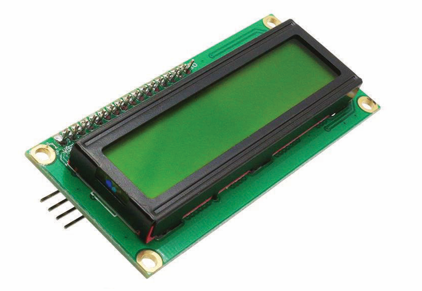
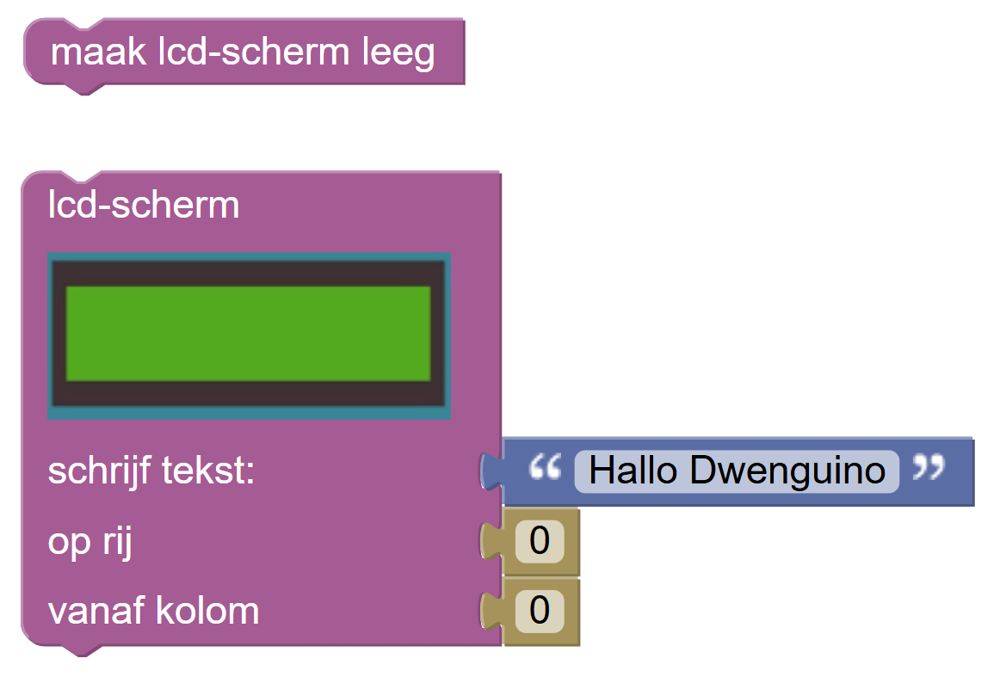
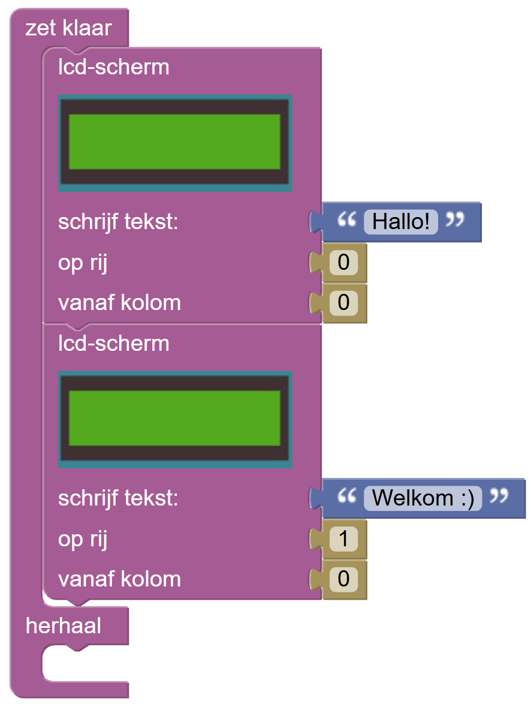

    <h1 class="title">LCD - Liquid Crystal Display</h1>
    

        

            <h3 class="info_item_title">In het echt</h3>
                </img>
        

        

            <h3 class="info_item_title">In de simulator</h3>
                </img>
        

        

            <h3 class="info_item_title">Programmeerblokken</h3>
                </img>
        

        

            <h3 class="info_item_title">Werking</h3>
            

                Een LCD kan tekst weergeven om bijvoorbeeld een boodschap mee te delen. 
                Op het scherm van de dwenguino passen maximaal 32 karakters, zoals letters of cijfers. Dit is verspreid over twee regels, dus je kan 16 karakters per regel tonen.  
                <b>Blok 1</b> maakt het LCD op de dwenguino leeg. 
                <b>Blok 2</b> kun je in combinatie met een 'tekst'-blok gebruiken om ergens op het scherm iets te printen.
            

        

        

            <h3 class="info_item_title">Voorbeeld</h3>
                </img>
            

                Dit voorbeeld zorgt ervoor dat de tekst 'Hallo!' getoond wordt op de bovenste rij van het LCD en de tekst 'Welkom :)' op de onderste.
            

        

    

