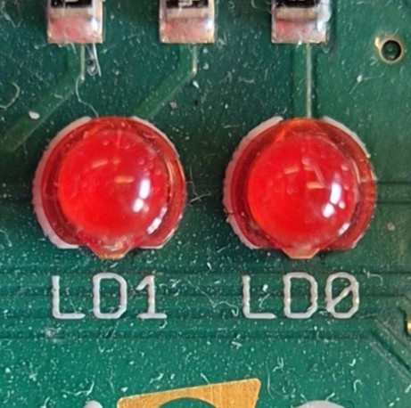
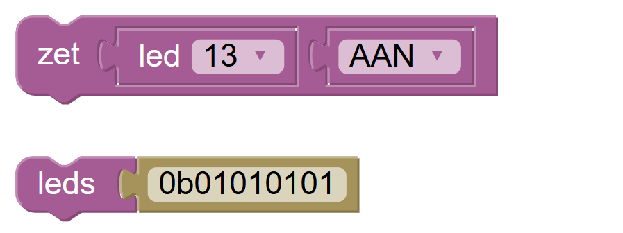
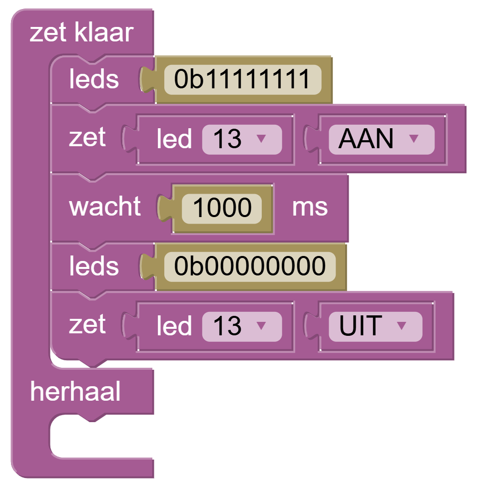

    <h1 class="title">LED - Light-Emitting Diode</h1>
    

        

            <h3 class="info_item_title">In het echt</h3>
                </img>
        

        

            <h3 class="info_item_title">In de simulator</h3>
                </img>
        

        

            <h3 class="info_item_title">Programmeerblokken</h3>
                </img>
        

        

            <h3 class="info_item_title">Werking</h3>
            

                LEDs zijn lampjes die je aan en uit kan zetten. 
                De dwenguino heeft 9 ingebouwde rode LEDs die je kunt gebruiken. LD0 tot en met LD7 staan op één rij en kun je gezamelijk aansturen, LD13 staat afzonderlijk in de linkerbovenhoed van het bordje.  
                <b>Blok 1</b> kun je gebruiken om één specifieke LED aan of uit te zetten. 
                Met <b>blok 2</b> kun je meteen een volledig patroon meegeven aan de onderste rij van LEDs. Een '1' betekent dat de LED zal branden, bij een '0' niet.
            

        

        

            <h3 class="info_item_title">Voorbeeld</h3>
                </img>
            

                Dit voorbeeld zet alle LEDs aan, laat ze één seconde branden en zet ze dan weer allemaal uit.
            

        

    

