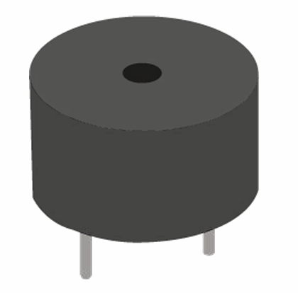
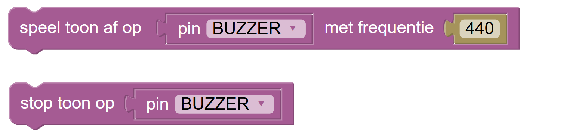
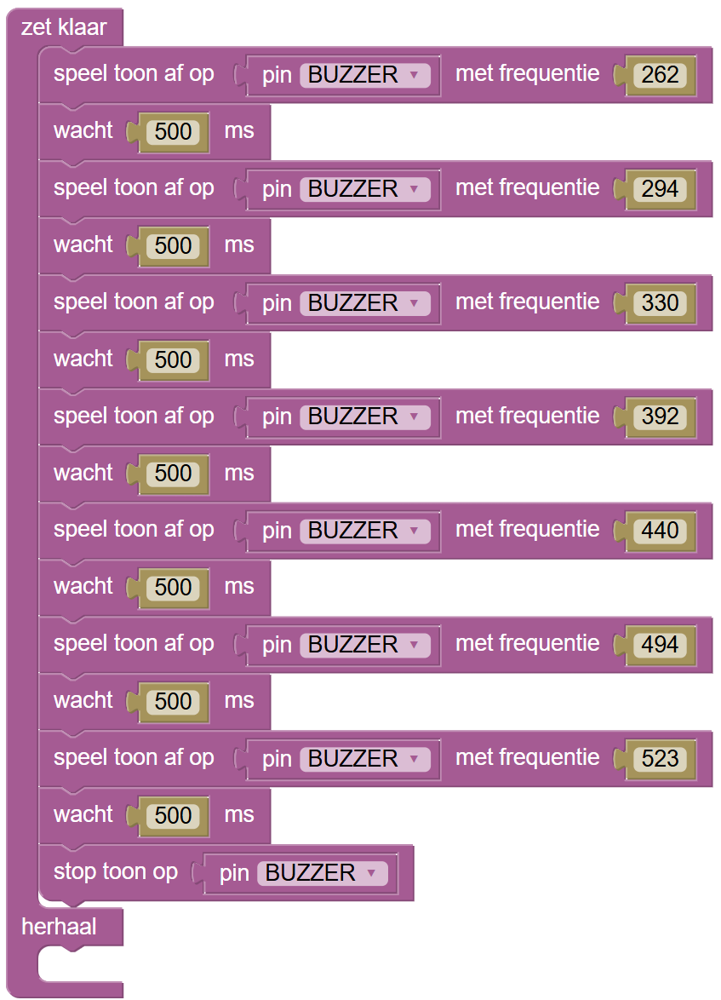

    <h1 class="title">Buzzer</h1>
    

        

            <h3 class="info_item_title">In het echt</h3>
                </img>
        

        

            <h3 class="info_item_title">In de simulator</h3>
                </img>
        

        

            <h3 class="info_item_title">Programmeerblokken</h3>
                </img>
        

        

            <h3 class="info_item_title">Werking</h3>
            

                De buzzer trilt om de lucht om zich heen ook te doen trillen en zo geluid te maken. De toon van het geluid wordt bepaald door het aantal trillingen per seconde, ook wel de frequentie genoemd. De eenheid hiervoor is Hertz (Hz) en de mens kan geluiden horen tussen de 20 Hz en 20.000 Hz.  
                <b>Blok 1</b> laat de buzzer een toon afspelen met de gevraagde frequentie. 
                <b>Blok 2</b> stopt de buzzer.
            

        

        

            <h3 class="info_item_title">Voorbeeld</h3>
                </img>
            

                Dit voorbeeld speelt de volledige toonladder af. Elke toon wordt een halve seconde aangehouden.
            

        

    

